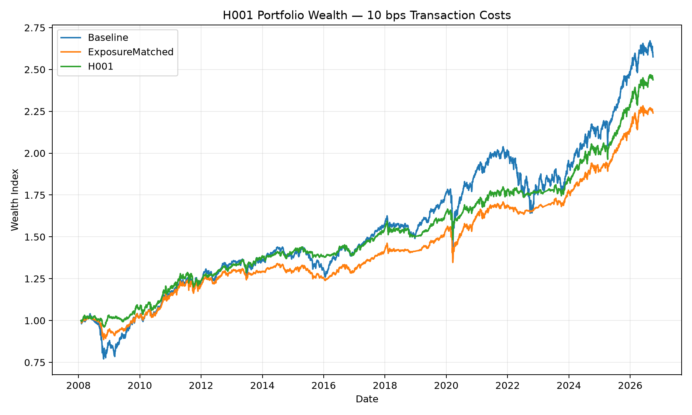
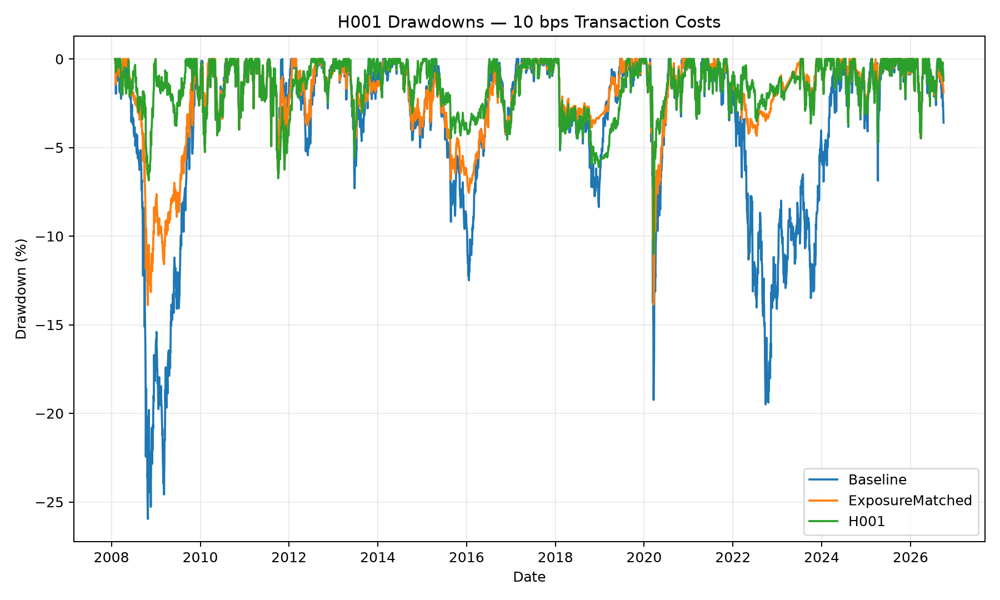

# QuantLab

QuantLab is a compact quantitative research framework for testing systematic portfolio ideas with explicit assumptions around **signal formation, execution, transaction costs, risk and reproducibility**.

The current experiment, **H001**, studies whether a time-series momentum risk gate changes the risk-adjusted behaviour of an inverse-volatility ETF portfolio.

## Results at a glance

Primary results use **10 bps per unit of gross ETF notional traded**.

| Strategy | CAGR | Volatility | Sharpe | Max Drawdown | Final Wealth |
|---|---:|---:|---:|---:|---:|
| Baseline | **5.199%** | 8.739% | 0.459 | -25.958% | **2.575** |
| ExposureMatched | 4.416% | 5.467% | 0.555 | -13.894% | 2.240 |
| H001 | 4.891% | **5.402%** | **0.645** | **-11.009%** | 2.438 |

The fully invested baseline has the highest historical CAGR. H001 shows lower realized volatility and maximum drawdown and a higher historical Sharpe ratio.

These are **historical descriptive results**, not evidence of alpha or future profitability. H001 also spends substantial time in cash, so the experiment includes an exposure-matched control to separate some of the effect of lower risky exposure from the momentum gate itself.

## H001 — Time-Series Momentum Risk Gate

The ETF universe is:

`SPY`, `IWM`, `EFA`, `EEM`, `IEF`, `LQD`, `GLD`, `DBC`

The baseline is fully invested using inverse-volatility weights.

H001 applies a 252-session excess-momentum filter:

- positive excess momentum: retain the inverse-volatility allocation;
- non-positive excess momentum: set the ETF target weight to zero;
- removed allocation moves to cash;
- surviving ETF weights are not renormalized.

Volatility is estimated over 60 sessions and portfolios are rebalanced monthly.

Cash earns a return derived from the FRED `DGS3MO` series.

## Execution convention

A signal or target calculated using `close(t)` is executed at the close of the next observed trading session, `close(t+1)`.

The new target therefore first earns the return from `close(t+1)` to `close(t+2)`.

This deliberately avoids treating information observed at `close(t)` as executable at the same close.

Portfolio weights drift naturally between rebalances.

Transaction costs are charged on gross traded ETF notional. The residual cash funding leg is not counted again as traded notional.

This is a simplified proportional transaction-cost model. It does not model bid-ask spreads, market impact or an exact self-financing execution solver.

## Exposure-matched attribution control

Because H001 frequently allocates capital to cash, the experiment also includes an `ExposureMatched` control.

At each rebalance date,

\[
\alpha_t = \sum_i w^{H001}_{i,t}
\]

and the control scales the baseline inverse-volatility portfolio as

\[
w^{matched}_{i,t}
=
\alpha_t w^{baseline}_{i,t}.
\]

The remaining allocation is held in cash.

The control therefore preserves the baseline relative ETF composition while matching H001's **target aggregate ETF exposure at every rebalance**.

For the primary experiment:

- average H001 target ETF exposure: **65.186%**;
- maximum target-exposure difference between H001 and ExposureMatched: **0.000000 percentage points**;
- mean realized end-of-day exposure difference: **0.145510 percentage points**;
- maximum realized end-of-day exposure difference: **2.655765 percentage points**.

Realized daily exposures can diverge after a rebalance because the two portfolios hold different assets and their weights drift differently.

`ExposureMatched` is therefore an attribution control, not an exact daily risk match. It does not equalize realized volatility, factor exposures, portfolio composition or transaction costs.

At 10 bps, H001 historically produced a higher CAGR and Sharpe ratio and a smaller maximum drawdown than this control.

That comparison suggests the observed result is not explained solely by H001's lower target risky exposure, but it does not establish a causal or out-of-sample performance advantage.

## Robustness

Transaction costs are evaluated at:

`0`, `5`, `10`, and `20` bps.

The main risk-adjusted pattern remains present across those scenarios.

The strategy is also evaluated over four predefined subperiods. H001 exceeds the exposure-matched control in CAGR and Sharpe in three of the four periods.

The main exception is **2018–2022**, where the matched portfolio has higher CAGR and Sharpe while H001 retains the smaller maximum drawdown.

A local parameter grid evaluates:

- volatility windows: `40`, `60`, `90`;
- momentum lookbacks: `189`, `252`, `315`.

All parameter combinations are compared over the same evaluation sample, beginning only after every specification has completed its initial deployment:

- evaluation start: `2008-05-02`;
- evaluation end: `2026-09-30`;
- observations: `4632`.

Across all 9 combinations, H001 has higher CAGR, higher Sharpe and a smaller maximum drawdown than its corresponding exposure-matched control.

The original `60 / 252` specification remains fixed. The grid is a descriptive robustness check, not a parameter-selection exercise.

The nine variants are overlapping historical experiments and should not be interpreted as independent statistical evidence.

## Figures

### Wealth



### Drawdown



## Project structure

```text
src/quantlab/
├── data/
├── evaluation/
├── features/
├── portfolio/
├── signals/
└── simulation/

tests/
├── integration/
└── unit/

scripts/
├── download_h001_data.py
├── export_h001_results.py
├── generate_h001_manifest.py
├── run_h001_backtest.py
└── run_h001_sensitivity.py

results/h001/
figures/h001/
```

Research-specific experiment construction is kept separate from reusable data, feature, portfolio, simulation and evaluation components.

## Tests

The test suite covers:

- returns, volatility and momentum;
- cash-return calculations;
- inverse-volatility allocation;
- exposure matching;
- monthly rebalance timing;
- next-close execution;
- portfolio accounting and weight drift;
- transaction-cost timing;
- execution at the final available boundary;
- market-data calendar validation;
- drawdown and performance metrics;
- an end-to-end H001 research pipeline;
- a future-data perturbation check for past target invariance.

Run:

```bash
pytest -v
```

Current local validation:

```text
35 passed
```

GitHub Actions tests the project on Python `3.11` and `3.13`.

## Data and reproducibility

Raw market-data snapshots are intentionally excluded from the repository.

H001 uses:

- Tiingo adjusted ETF prices;
- FRED `DGS3MO` as the cash-rate proxy;
- requested data range: `2007-01-01` to `2026-09-30`.

The ETF snapshots used for the published experiment contain 4967 common trading sessions from `2007-01-03` through `2026-09-30`.

The loader requires all ETF snapshots to share exactly the same observed-session calendar and rejects incomplete terminal snapshots.

### Environment

For the exact direct-package versions used to regenerate H001:

```bash
python -m venv .venv
source .venv/bin/activate
python -m pip install --upgrade pip
python -m pip install -r requirements-h001-lock.txt
python -m pip install -e . --no-deps
```

The package itself retains broader dependency declarations in `pyproject.toml`; `requirements-h001-lock.txt` records the direct-package versions used for this experiment.

### Downloading data

Set a valid Tiingo API key in the local environment and run:

```bash
python scripts/download_h001_data.py
```

Existing snapshots are not overwritten by default.

New downloads record provider retrieval timestamps locally. The original H001 snapshots predate this mechanism, so their provider retrieval timestamps are explicitly reported as unavailable rather than inferred from filesystem metadata.

### Reproducing H001

With the required data available:

```bash
python scripts/run_h001_backtest.py
python scripts/run_h001_sensitivity.py
python scripts/export_h001_results.py
python scripts/generate_h001_manifest.py
pytest -v
```

Generated research tables are stored in `results/h001/`.

`results/h001/data_manifest.json` records:

- requested and actual date ranges;
- row counts;
- SHA-256 hashes of the source snapshots;
- data conventions;
- retrieval metadata when genuinely available;
- Python and package versions;
- Git metadata at manifest generation time.

Filesystem modification timestamps are kept separate from provider retrieval timestamps.

## Modelling conventions

ETF signals use adjusted closing prices.

Volatility is the 60-session standard deviation of adjusted simple daily returns, annualized with `sqrt(252)`.

ETF momentum is the trailing 252-session adjusted return.

Cash momentum uses the corresponding trailing return of the cash proxy.

The daily cash-return approximation uses the previous observed annual `DGS3MO` percentage yield divided by `100` and `252`.

Sharpe ratios use daily portfolio returns in excess of the aligned cash return.

## Limitations

H001 is a historical research experiment rather than a deployable trading claim.

Important limitations include:

- retrospective ETF-universe selection;
- no pristine untouched out-of-sample dataset;
- no formal claim that the parameter variants are statistically independent;
- simplified conversion of Treasury yields into daily cash returns;
- constant proportional transaction costs;
- no bid-ask spread or explicit market-impact model;
- dependence on adjusted-price data supplied by the provider;
- an exposure-matched control that equalizes target risky allocation, not realized risk or factor exposure.

Further work should prioritize genuinely prospective validation rather than additional optimization on the same historical sample.

## Status

**H001 complete.**
